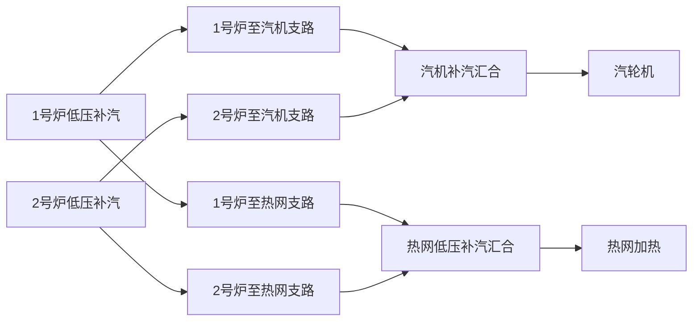

# 两炉低压系统检查、修改与全部缺测点

日期：2026-10-13。以当前topology.md为准；单位按用户要求不作为问题统计。

每炉旧设备17→13，删除省煤器旁路、蒸汽旁路、排污和高压泵回流连接。低压回水及汽包水名称与当前拓扑对齐，补齐高中压供水母管定义，专用构建入口不依赖已删除cooling。

## 本次确认的连接

每台锅炉主汽经分叉后，一路至汽轮机、一路至热网；两炉按相同目的地分别汇合。代码保留至汽机支路的既有实测P/T；至热网支路按简单分叉出口取本炉主汽P/T，共同母管状态不跨位置复制。

## 原始数据完整性

| 炉号 | 绑定输入 | 有历史 | 缺历史 | 无选定测点/需状态定义 |
| --- | --- | --- | --- | --- |
| 1 | 23（含3个复用HP/IP流量） | 17 | 6 | 4 |
| 2 | 23（含3个复用HP/IP流量） | 17 | 6 | 4 |

## 已选编码但缺历史文件（全部）

| 算法字段 | 含义 | 原始编码 |
| --- | --- | --- |
| `hrsg1.lp_from_heat_recovery.P` | 至#1炉烟气热网再循环凝结水压力 | `GARD_11HAA13QN101BP02XQ01` |
| `hrsg1.lp_from_heat_recovery.T` | 1号炉烟气换热器凝结水出口温度 | `GARD_11HAA11WP011BT02XQ01` |
| `hrsg1.lp_drum_pressure` | #1炉低压汽包压力选择值 | `GARD_11HBK11CM001BP02XQ01` |
| `hrsg1.lp_economizer_in.T` | #1炉低压省煤器进水温度 | `GARD_11HAA70WP021BT02XQ01` |
| `hrsg1.lp_recirc_in.m_dot` | #1炉低压省煤器再循环流量 | `GARD_11HAA85WP001BF01XQ01` |
| `hrsg1.lp_recirc_pump2.current` | #1炉低省#2再循环泵电流 | `GARD_11HAA85GP002BC02XQ01` |
| `hrsg2.lp_from_heat_recovery.P` | 至#2炉烟气热网再循环凝结水压力 | `GARD_12HAA13QN101BP02XQ01` |
| `hrsg2.lp_from_heat_recovery.T` | #2炉烟气水水换热凝结水出口温度 | `GARD_12HAA11WP011BT02XQ01` |
| `hrsg2.lp_drum_pressure` | #2炉低压汽包压力选择值 | `GARD_12HAG11CM001BP02XQ01` |
| `hrsg2.lp_economizer_in.T` | #2炉低压省煤器进水温度 | `GARD_12HAA70WP021BT02XQ01` |
| `hrsg2.lp_recirc_in.m_dot` | #2炉低压省煤器再循环流量 | `GARD_12HAA85WP001BF01XQ01` |
| `hrsg2.lp_recirc_pump2.current` | #2炉低省#2再循环泵电流 | `GARD_12HAA85GP002BC02XQ01` |

## 还缺的独立测点或状态定义（全部）

以下不是都必须新增仪表。可确认合适现有取点或明确状态近似；编码未核实的留空。每炉单列，不把派生字段作为采集点。

| 算法字段 | 含义 | 需要的信息 |
| --- | --- | --- |
| `hrsg1.lp_feed.P` | 余热回收返回混合前低压给水压力 | 原HAA70压力已按用户指定移至混合后；混合前需独立测点或明确近似 |
| `hrsg1.lp_feed.T` | 余热回收返回混合前低压给水温度 | 原HAA70温度已按用户指定移至混合后；不能把同一测温当作混合前实测 |
| `hrsg1.lp_to_heat_recovery.m_dot` | 水水换热器工质侧循环总流量 | 用户明确暂留空；闭合循环返回量等于送出量，但不能由给水量推得循环量 |
| `hrsg1.lp_to_heat.m_dot` | 本炉低压蒸汽至供热流量 | 每炉需要一个独立分流依据；全厂供热总流量不能唯一分配到两炉 |
| `hrsg2.lp_feed.P` | 余热回收返回混合前低压给水压力 | 原HAA70压力已按用户指定移至混合后；混合前需独立测点或明确近似 |
| `hrsg2.lp_feed.T` | 余热回收返回混合前低压给水温度 | 原HAA70温度已按用户指定移至混合后；不能把同一测温当作混合前实测 |
| `hrsg2.lp_to_heat_recovery.m_dot` | 水水换热器工质侧循环总流量 | 用户明确暂留空；闭合循环返回量等于送出量，但不能由给水量推得循环量 |
| `hrsg2.lp_to_heat.m_dot` | 本炉低压蒸汽至供热流量 | 每炉需要一个独立分流依据；全厂供热总流量不能唯一分配到两炉 |
| `heat.lp_steam_header.P` | 两炉低压供热支路汇合后母管压力 | 新确认汇合节点；尚未选定测点或混合压力近似 |
| `heat.lp_steam_header.T` | 两炉低压供热支路汇合后母管温度 | 尚未选定测点；两炉温度不同时不能直接复制任一炉温度 |

## 派生规则与边界

- 每炉13设备，与当前拓扑一致；移除每炉24个旧字段
- 沿用单泵互备、默认10 A阈值；此为可配置运行假设，电流不能计算电功
- 泵出口温度等于入口温度；低压再循环泵入口为省煤器出口状态
- 默认水水换热器工质侧稳态无泄漏，返回量等于送出量；不含热网循环水
- 余热回收混合后P/T用HAA70WP021BP01/BT01；省煤器进出口P用同一压力，给水阀后P用汽包P
- 省煤器入口T优先测点BT02；缺失时具备混合流量、状态和出口P才按焓流计算
- 供热支路为主汽简单分叉出口，P/T取本炉主汽；两炉至汽机支路、至供热支路分别汇合，不均分流量
- 热网低压补汽汇合母管P/T仍独立；本次仅连接该工质侧汇合节点，未重构其余热网设备
- 保留独立低压给水与汽包总出口质量差；系统功/热量/热量火用缺失时不输出完整能量/火用结果

高压取水量=hp_main.m_dot；中压取水量=ip_feed.m_dot+rh_spray.m_dot；汽包水总量为两者之和。再循环是内部流量，不能等同低压总给水。低压供热量需要单炉分流依据，至汽机量取主汽减供热量，负差值保持None。

低压汽包水x=0、饱和蒸汽x=1。余热回收混合后T按用户指定使用实测BT01，不再由混合焓替代。省煤器进水T测点BT02有编码但缺文件，具备混合流量、入口状态及P时可派生模型值，不宣称恢复了实测数据。

HAA80QN102BP01原描述为低压汽包进水压力，保留既有lp_drum_valve_in.P绑定，阀前安装位置尚需核对；不影响已确认的省煤器P和阀后P规则

用户称“热网疏水”的测点接在本低压图水水换热器工质侧返回口lp_from_heat_recovery，不替换供热蒸汽冷凝后的heat.drain_return。1号炉按指定11HAA11WP011BT02/11HAA13QN101BP02接入；2号炉已核实点表中12HAA11WP011BT02/12HAA13QN101BP02对应测点，按相同规则接入。原点表记录全部保留，单位不计未解决问题。

原HAA70给水P/T重新定位到混合后；混合前lp_feed.P/T另需定义。BP04原描述是至汽机温度，保留绑定，不按编码字母换点。循环返回流量在闭合近似下派生；关闭该近似时lp_from_heat_recovery.m_dot另需输入。

本轮实际窗口为2024-06-01 00:30–01:00（Asia/Shanghai），用于有限覆盖核查，不代表稳定运行工况。运行识别在原始时间序列上完成，均值不能掩盖切泵。具体覆盖、字段及原点表位置见JSON。

## 全部活动字段

| 算法字段 | 类型 | 定义 / 算法 |
| --- | --- | --- |
| `hrsg1.lp_feed.P` | point_or_definition_missing | 原HAA70压力已按用户指定移至混合后；混合前需独立测点或明确近似 |
| `hrsg1.lp_feed.T` | point_or_definition_missing | 原HAA70温度已按用户指定移至混合后；不能把同一测温当作混合前实测 |
| `hrsg1.lp_feed.m_dot` | raw_bound | 原始外部输入；缺文件与缺测点定义分开统计 |
| `hrsg1.lp_economizer_in.P` | derived | 用户确认等于lp_feed_after_recovery.P（HAA70WP021BP01） |
| `hrsg1.lp_economizer_in.T` | raw_bound | 原始外部输入；缺文件与缺测点定义分开统计 |
| `hrsg1.lp_economizer_in.m_dot` | derived | lp_feed_after_recovery.m_dot+lp_recirc_in.m_dot |
| `hrsg1.lp_economizer_out.P` | derived | 用户确认等于lp_feed_after_recovery.P（HAA70WP021BP01） |
| `hrsg1.lp_economizer_out.T` | raw_bound | 原始外部输入；缺文件与缺测点定义分开统计 |
| `hrsg1.lp_economizer_out.m_dot` | derived | lp_economizer_in.m_dot |
| `hrsg1.lp_drum_valve_in.P` | raw_bound | 原始外部输入；缺文件与缺测点定义分开统计 |
| `hrsg1.lp_drum_valve_in.T` | derived | 当前无旁路分流节点，取lp_economizer_out.T |
| `hrsg1.lp_drum_valve_in.m_dot` | derived | 闭合循环默认等于lp_feed.m_dot，循环量缺失仍可确定；非闭合时为给水+返回-送出 |
| `hrsg1.lp_to_drum.P` | derived | 用户确认给水阀后压力等于lp_drum_pressure |
| `hrsg1.lp_to_drum.T` | raw_bound | 原始外部输入；缺文件与缺测点定义分开统计 |
| `hrsg1.lp_to_drum.m_dot` | derived | 等于lp_drum_valve_in.m_dot，不强制与汽包出口总量相等 |
| `hrsg1.lp_to_heat_recovery.P` | derived | 当前分流节点取lp_economizer_out.P，暂不增加管路压降/散热 |
| `hrsg1.lp_to_heat_recovery.T` | derived | 当前分流节点取lp_economizer_out.T，暂不增加管路压降/散热 |
| `hrsg1.lp_to_heat_recovery.m_dot` | point_or_definition_missing | 用户明确暂留空；闭合循环返回量等于送出量，但不能由给水量推得循环量 |
| `hrsg1.lp_from_heat_recovery.P` | raw_bound | 原始外部输入；缺文件与缺测点定义分开统计 |
| `hrsg1.lp_from_heat_recovery.T` | raw_bound | 原始外部输入；缺文件与缺测点定义分开统计 |
| `hrsg1.lp_from_heat_recovery.m_dot` | derived | 默认稳态无泄漏工质侧闭合循环，等于lp_to_heat_recovery.m_dot；配置可关闭此近似 |
| `hrsg1.lp_feed_after_recovery.P` | raw_bound | 原始外部输入；缺文件与缺测点定义分开统计 |
| `hrsg1.lp_feed_after_recovery.T` | raw_bound | 原始外部输入；缺文件与缺测点定义分开统计 |
| `hrsg1.lp_feed_after_recovery.m_dot` | derived | lp_feed.m_dot+lp_from_heat_recovery.m_dot |
| `hrsg1.lp_recirc_in.P` | derived | 当前分流节点取lp_economizer_out.P，暂不增加管路压降/散热 |
| `hrsg1.lp_recirc_in.T` | derived | 当前分流节点取lp_economizer_out.T，暂不增加管路压降/散热 |
| `hrsg1.lp_recirc_in.m_dot` | raw_bound | 原始外部输入；缺文件与缺测点定义分开统计 |
| `hrsg1.lp_recirc_pump1_in.P` | derived | lp_economizer_out.P，来自省煤器而非汽包饱和水 |
| `hrsg1.lp_recirc_pump1_in.T` | derived | lp_economizer_out.T（泵出口T等于入口T近似） |
| `hrsg1.lp_recirc_pump1_in.m_dot` | derived | 唯一运行泵承担再循环总量，备用0；原始时序切泵/矛盾时None |
| `hrsg1.lp_recirc_pump2_in.P` | derived | lp_economizer_out.P，来自省煤器而非汽包饱和水 |
| `hrsg1.lp_recirc_pump2_in.T` | derived | lp_economizer_out.T（泵出口T等于入口T近似） |
| `hrsg1.lp_recirc_pump2_in.m_dot` | derived | 唯一运行泵承担再循环总量，备用0；原始时序切泵/矛盾时None |
| `hrsg1.lp_recirc_pump1_out.P` | raw_bound | 原始外部输入；缺文件与缺测点定义分开统计 |
| `hrsg1.lp_recirc_pump1_out.T` | derived | lp_economizer_out.T（泵出口T等于入口T近似） |
| `hrsg1.lp_recirc_pump1_out.m_dot` | derived | 唯一运行泵承担再循环总量，备用0；原始时序切泵/矛盾时None |
| `hrsg1.lp_recirc_pump2_out.P` | raw_bound | 原始外部输入；缺文件与缺测点定义分开统计 |
| `hrsg1.lp_recirc_pump2_out.T` | derived | lp_economizer_out.T（泵出口T等于入口T近似） |
| `hrsg1.lp_recirc_pump2_out.m_dot` | derived | 唯一运行泵承担再循环总量，备用0；原始时序切泵/矛盾时None |
| `hrsg1.lp_recirc_out.P` | derived | 唯一运行再循环泵出口P；运行状态不可判定时None |
| `hrsg1.lp_recirc_out.T` | derived | 运行泵出口T，按已确认的泵出口T等于入口T近似 |
| `hrsg1.lp_recirc_out.m_dot` | derived | lp_recirc_in.m_dot |
| `hrsg1.lp_drum_pressure` | raw_bound | 原始外部输入；缺文件与缺测点定义分开统计 |
| `hrsg1.lp_water.m_dot` | derived | hp_main.m_dot+ip_feed.m_dot+rh_spray.m_dot |
| `hrsg1.lp_saturated_steam.m_dot` | derived | lp_main.m_dot（简化稳态过热器无额外分流） |
| `hrsg1.lp_main.P` | raw_bound | 原始外部输入；缺文件与缺测点定义分开统计 |
| `hrsg1.lp_main.T` | raw_bound | 原始外部输入；缺文件与缺测点定义分开统计 |
| `hrsg1.lp_main.m_dot` | raw_bound | 原始外部输入；缺文件与缺测点定义分开统计 |
| `hrsg1.lp_to_st.P` | raw_bound | 原始外部输入；缺文件与缺测点定义分开统计 |
| `hrsg1.lp_to_st.T` | raw_bound | 原始外部输入；缺文件与缺测点定义分开统计 |
| `hrsg1.lp_to_st.m_dot` | derived | lp_main.m_dot-lp_to_heat.m_dot，负差值None |
| `hrsg1.lp_to_heat.P` | derived | 简单分叉出口取lp_main.P；不代表下游共同母管压力 |
| `hrsg1.lp_to_heat.T` | derived | 简单分叉出口取lp_main.T；不代表下游共同母管温度 |
| `hrsg1.lp_to_heat.m_dot` | point_or_definition_missing | 每炉需要一个独立分流依据；全厂供热总流量不能唯一分配到两炉 |
| `hrsg1.hp_pump_in.m_dot` | derived | hp_main.m_dot（已确认高压供水总量） |
| `hrsg1.ip_pump_in.m_dot` | derived | ip_feed.m_dot+rh_spray.m_dot（已确认中压供水总量） |
| `hrsg2.lp_feed.P` | point_or_definition_missing | 原HAA70压力已按用户指定移至混合后；混合前需独立测点或明确近似 |
| `hrsg2.lp_feed.T` | point_or_definition_missing | 原HAA70温度已按用户指定移至混合后；不能把同一测温当作混合前实测 |
| `hrsg2.lp_feed.m_dot` | raw_bound | 原始外部输入；缺文件与缺测点定义分开统计 |
| `hrsg2.lp_economizer_in.P` | derived | 用户确认等于lp_feed_after_recovery.P（HAA70WP021BP01） |
| `hrsg2.lp_economizer_in.T` | raw_bound | 原始外部输入；缺文件与缺测点定义分开统计 |
| `hrsg2.lp_economizer_in.m_dot` | derived | lp_feed_after_recovery.m_dot+lp_recirc_in.m_dot |
| `hrsg2.lp_economizer_out.P` | derived | 用户确认等于lp_feed_after_recovery.P（HAA70WP021BP01） |
| `hrsg2.lp_economizer_out.T` | raw_bound | 原始外部输入；缺文件与缺测点定义分开统计 |
| `hrsg2.lp_economizer_out.m_dot` | derived | lp_economizer_in.m_dot |
| `hrsg2.lp_drum_valve_in.P` | raw_bound | 原始外部输入；缺文件与缺测点定义分开统计 |
| `hrsg2.lp_drum_valve_in.T` | derived | 当前无旁路分流节点，取lp_economizer_out.T |
| `hrsg2.lp_drum_valve_in.m_dot` | derived | 闭合循环默认等于lp_feed.m_dot，循环量缺失仍可确定；非闭合时为给水+返回-送出 |
| `hrsg2.lp_to_drum.P` | derived | 用户确认给水阀后压力等于lp_drum_pressure |
| `hrsg2.lp_to_drum.T` | raw_bound | 原始外部输入；缺文件与缺测点定义分开统计 |
| `hrsg2.lp_to_drum.m_dot` | derived | 等于lp_drum_valve_in.m_dot，不强制与汽包出口总量相等 |
| `hrsg2.lp_to_heat_recovery.P` | derived | 当前分流节点取lp_economizer_out.P，暂不增加管路压降/散热 |
| `hrsg2.lp_to_heat_recovery.T` | derived | 当前分流节点取lp_economizer_out.T，暂不增加管路压降/散热 |
| `hrsg2.lp_to_heat_recovery.m_dot` | point_or_definition_missing | 用户明确暂留空；闭合循环返回量等于送出量，但不能由给水量推得循环量 |
| `hrsg2.lp_from_heat_recovery.P` | raw_bound | 原始外部输入；缺文件与缺测点定义分开统计 |
| `hrsg2.lp_from_heat_recovery.T` | raw_bound | 原始外部输入；缺文件与缺测点定义分开统计 |
| `hrsg2.lp_from_heat_recovery.m_dot` | derived | 默认稳态无泄漏工质侧闭合循环，等于lp_to_heat_recovery.m_dot；配置可关闭此近似 |
| `hrsg2.lp_feed_after_recovery.P` | raw_bound | 原始外部输入；缺文件与缺测点定义分开统计 |
| `hrsg2.lp_feed_after_recovery.T` | raw_bound | 原始外部输入；缺文件与缺测点定义分开统计 |
| `hrsg2.lp_feed_after_recovery.m_dot` | derived | lp_feed.m_dot+lp_from_heat_recovery.m_dot |
| `hrsg2.lp_recirc_in.P` | derived | 当前分流节点取lp_economizer_out.P，暂不增加管路压降/散热 |
| `hrsg2.lp_recirc_in.T` | derived | 当前分流节点取lp_economizer_out.T，暂不增加管路压降/散热 |
| `hrsg2.lp_recirc_in.m_dot` | raw_bound | 原始外部输入；缺文件与缺测点定义分开统计 |
| `hrsg2.lp_recirc_pump1_in.P` | derived | lp_economizer_out.P，来自省煤器而非汽包饱和水 |
| `hrsg2.lp_recirc_pump1_in.T` | derived | lp_economizer_out.T（泵出口T等于入口T近似） |
| `hrsg2.lp_recirc_pump1_in.m_dot` | derived | 唯一运行泵承担再循环总量，备用0；原始时序切泵/矛盾时None |
| `hrsg2.lp_recirc_pump2_in.P` | derived | lp_economizer_out.P，来自省煤器而非汽包饱和水 |
| `hrsg2.lp_recirc_pump2_in.T` | derived | lp_economizer_out.T（泵出口T等于入口T近似） |
| `hrsg2.lp_recirc_pump2_in.m_dot` | derived | 唯一运行泵承担再循环总量，备用0；原始时序切泵/矛盾时None |
| `hrsg2.lp_recirc_pump1_out.P` | raw_bound | 原始外部输入；缺文件与缺测点定义分开统计 |
| `hrsg2.lp_recirc_pump1_out.T` | derived | lp_economizer_out.T（泵出口T等于入口T近似） |
| `hrsg2.lp_recirc_pump1_out.m_dot` | derived | 唯一运行泵承担再循环总量，备用0；原始时序切泵/矛盾时None |
| `hrsg2.lp_recirc_pump2_out.P` | raw_bound | 原始外部输入；缺文件与缺测点定义分开统计 |
| `hrsg2.lp_recirc_pump2_out.T` | derived | lp_economizer_out.T（泵出口T等于入口T近似） |
| `hrsg2.lp_recirc_pump2_out.m_dot` | derived | 唯一运行泵承担再循环总量，备用0；原始时序切泵/矛盾时None |
| `hrsg2.lp_recirc_out.P` | derived | 唯一运行再循环泵出口P；运行状态不可判定时None |
| `hrsg2.lp_recirc_out.T` | derived | 运行泵出口T，按已确认的泵出口T等于入口T近似 |
| `hrsg2.lp_recirc_out.m_dot` | derived | lp_recirc_in.m_dot |
| `hrsg2.lp_drum_pressure` | raw_bound | 原始外部输入；缺文件与缺测点定义分开统计 |
| `hrsg2.lp_water.m_dot` | derived | hp_main.m_dot+ip_feed.m_dot+rh_spray.m_dot |
| `hrsg2.lp_saturated_steam.m_dot` | derived | lp_main.m_dot（简化稳态过热器无额外分流） |
| `hrsg2.lp_main.P` | raw_bound | 原始外部输入；缺文件与缺测点定义分开统计 |
| `hrsg2.lp_main.T` | raw_bound | 原始外部输入；缺文件与缺测点定义分开统计 |
| `hrsg2.lp_main.m_dot` | raw_bound | 原始外部输入；缺文件与缺测点定义分开统计 |
| `hrsg2.lp_to_st.P` | raw_bound | 原始外部输入；缺文件与缺测点定义分开统计 |
| `hrsg2.lp_to_st.T` | raw_bound | 原始外部输入；缺文件与缺测点定义分开统计 |
| `hrsg2.lp_to_st.m_dot` | derived | lp_main.m_dot-lp_to_heat.m_dot，负差值None |
| `hrsg2.lp_to_heat.P` | derived | 简单分叉出口取lp_main.P；不代表下游共同母管压力 |
| `hrsg2.lp_to_heat.T` | derived | 简单分叉出口取lp_main.T；不代表下游共同母管温度 |
| `hrsg2.lp_to_heat.m_dot` | point_or_definition_missing | 每炉需要一个独立分流依据；全厂供热总流量不能唯一分配到两炉 |
| `hrsg2.hp_pump_in.m_dot` | derived | hp_main.m_dot（已确认高压供水总量） |
| `hrsg2.ip_pump_in.m_dot` | derived | ip_feed.m_dot+rh_spray.m_dot（已确认中压供水总量） |

## 实现及参数表验证

测试覆盖两炉运行识别、原始切泵、缺流量时实测状态保留、新压力定义覆盖旧值、混合前后测点分离、两路独立汇合、异常分流及输入不变。最新实际执行结果见lp_confirmed_validation.json。全厂旧注册表仍引用用户删除的cooling；本轮通过专用LP入口及独立汇合设备验证，未恢复cooling。

桌面表由252项调整为246项；已确认的派生状态不再独立采集，未确定测点编码留空。

保留第一条用户示例、原有非目标行、行高、列宽、样式及空白工作表，不新增自动换行。修改前备份：`C:\MyFolder\Projects\gtcc_optimization\outputs\20261013_lp_confirmed\support\previous_version.xlsx`。原始测点来源工作簿未改动。

执行：`python -X utf8 analysis/audit_lp_sources.py`。详细证据：[lp_source_audit.json](lp_source_audit.json)。原始点表只读，执行前后哈希一致。
