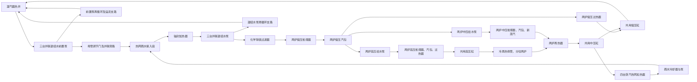
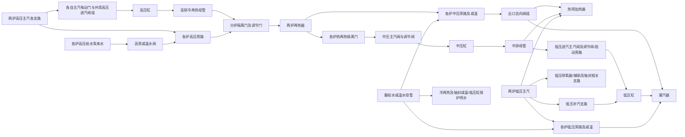

# GARD 汽水回路与测点核对

> 依据：`docs/02热机系统图.pdf`（262 个 PDF 页面）、`docs/点表-高安屯.xlsx`，以及 `docs/选取参数/控制.md`、`汽机和凝汽器.md` 所链接的九幅画面。更新日期：2026-09-30。本文页码均为**图纸印刷页 / PDF 页**。截图提供连接关系和控制结构，点表提供编码及原始描述；尚未取得组态逻辑或仪表接线表。截图时间为2026-09-29/30，原始数据分析区间为2024-06至2025-04，不能用截图当时的阀位、色块或读数给历史工况贴标签。

## 1. 先看清三种对象

1. **部件和端口**：泵、汽包、省煤器、过热器、汽轮机、加热器及其进出口是物理对象。一台设备的入口、出口、旁路口分别记录。
2. **图纸仪表**：图例（1/7）中，PI 是压力表、PT 是压力变送器，TI 是温度表、TE 是测温元件，FI 是流量表、FT 是流量变送器、FE 是流量测量元件；PDT/PDS 分别是差压变送器/差压开关。开关量不能当连续 P 值，差压不能当绝对压力。图中另有 PIC、TIC、PIA、PIS 等控制或报警标识，不把它们直接并入普通 PI/TI。
3. **DCS 点**：Excel 给出厂侧编码、智慧编码、描述、单位和点类型。图纸仪表圆圈通常**没有印出与 DCS `CP/CT/CF` 相同的逐点编号**；因此下表的“对应”只表示所在设备或管段、侧别和物理量相符，仍须由仪表索引或 I/O 清单核定同一只仪表。

下文 `11/12` 表示分别将前缀展开为 `11`（1 号炉）和 `12`（2 号炉），例如 `11/12LAB75CT601` 指两条独立的厂侧编码。`101–103` 表示三个独立点。表内 `—` 的意思是**本轮按该边界名称没有找到可直接绑定的记录**，不证明现场不存在仪表。PI/TI 等只表明相应图纸区域有该类符号，不能把母管点、阀前点或汽包本体点移到设备法兰。

## 2. 物理主回路

图中仅表示主流向及新核对的凝结水支路。三台泵为并联备选设备，不表示三台同时运行。高、中、低压旁路、减温水、排污、疏水和低压省煤器再循环须依据阀位加入具体工况；两台烟气热网水换热器是热网水侧的另一热源。轴封加热器位于前置泵与凝结水泵之间，热网疏水回流不能简单算作凝汽器热井来水。

## 3. 凝汽器、凝结水和低压锅炉

| 部件及物理端口 | 图纸及附近符号 | 压力 P：DCS 候选 | 温度 T：DCS 候选 | 流量：DCS 候选 | 位置与使用限制 |
|---|---|---|---|---|---|
| 凝汽器汽侧/热井 | 凝结水系统 151/172；PI、TI、液位仪表 | `10MAG01CP110` 凝汽器真空（kPa.a）；另有 `CP101–103` 真空点 | — | — | 真空是汽侧压力边界；热井水位 `10MAG10CL101–103` 不是水出口流量。 |
| 凝结水前置泵入口母管 | 151/172；PI、TI | `10LCA10CP101` | `10LCA10CT301` | — | **入口母管**，不是三台泵各自的入口法兰。 |
| 凝结水前置泵出口 | 151/172；PI、TI | 单泵 `10LCA11/12/13CP101`；出口母管 `10LCA20CP101` | 出口母管 `10LCA20CT301` | — | 单泵与母管分开；母管温度不可自动分配给每台泵。 |
| 凝结水泵入口上游共同管段 | 151/172；新增凝结水画面 | `10LCA40CP101`（轴封加热器出口） | `10LCA40CT301`（轴封加热器出口） | 上游 `10LCA20CF101-CAL`（轴封加热器入口） | 新画面确认加热器出口接三台凝结水泵入口母管；这些是共同管段代理，仍不是每台泵入口法兰实测。 |
| 凝结水泵出口及过滤器前后 | 151/172；新增凝结水画面 | 单泵 `10LCA41/42/43CP101`；出口母管 `10LCA50CP101`；至锅炉母管 `10LCA50CP102` | 至锅炉 `10LCA50CT302`；过滤器入口 `10LDB10CT301` | 至锅炉 `10LCA50CF102-CAL`；再循环 `10LCE64CF101-CAL` | 出口母管、滤器前后、锅炉母管分开；过滤器差压为 `10LDB10DP101`。主泵总通流不等于净入炉流量。 |
| 两炉低压省煤器入口 | 57/68、127/142；进水线 FT、TI | 上游共用母管可参考 `10LCA50CP101`；**非省煤器入口法兰点** | `11/12HAA70CT301`（冷凝水进水）、`CT302`（省煤器进水） | 原始 `11/12HAA70CF101–103`；选择值 `11/12HAA70CF101-SEL`（t/h） | 原始 CF 单位在 1 号炉为 Pa、2 号炉为 kPa，不能直接当 t/h。 |
| 两炉低压省煤器出口/低压汽包进水 | 57/68、127/142；TI、PI | `11/12HAA80CP101` 点名为**低压汽包进水压力** | 省煤器出水 `11/12HAA80CT301`；汽包进水 `CT302` | 入口选择值仅可作为稳态估算 | 省煤器出口与汽包给水口之间的阀门、再循环和管损仍须考虑。 |
| 两炉低压省煤器再循环 | 57/68、127/142；FT | — | — | `11/12HAA85CF101`（t/h）；还有计算点 `-X` | 再循环流量不能无条件加到净进水；2 号炉 `-X` 的点表单位标为 `%`，须复核。 |
| 两炉低压汽包本体 | 57/68、127/142；PI、TI | `11/12HAD90CP101–103` | `11/12HAD90CT601–602` | — | 本体 P/T 与给水口 P/T 分开；`CT611–614` 是水位补偿温度，不是蒸汽出口温度。 |
| 两炉低压过热器出口/低压主汽 | 57/68、127/142；主汽线 PI、TI、FT | `11/12LBA90CP101–103` | `11/12LBA90CT611–613` | 原始 `11/12LBA90CF101–103`；补偿选择值 `11/12LBA90CF101-SEL`（t/h） | 属锅炉低压主汽管段，之后才与中压缸排汽汇合；原始 CF 单位是 Pa/kPa。 |

## 4. 高压给水、锅炉与高压缸

| 部件及物理端口 | 图纸及附近符号 | 压力 P：DCS 候选 | 温度 T：DCS 候选 | 流量：DCS 候选 | 位置与使用限制 |
|---|---|---|---|---|---|
| 高压给水泵入口（两炉各两台） | 63/76、133/150 | — | — | — | 水来自本炉低压汽包；汽包本体 P/T 只能作为上游状态近似，不是泵入口测点。 |
| 高压给水泵单泵出口 | 63/76、133/150；每台泵出口附近 PI | `11/12LAB71CP101`、`11/12LAB72CP101` | — | — | 四台泵各有出口压力候选；与下游高压省煤器阀前测点不是同一点。 |
| 高压省煤器入口 | 61/74、131/148；给水线 PI、TI、FT | `11/12LAB75CP101`（隔离阀前）、`CP102`（调节阀前） | `11/12LAB75CT601` | 原始 `11/12LAB75CF101–103`；选择值 `11/12LAB75CF101-SEL`（t/h） | 压力点的阀前位置在 DCS 描述中写明，不能改称省煤器入口法兰压力。 |
| 高压省煤器出口/高压汽包进水 | 61/74、131/148 | — | `11/12HAC70CT601` 点名为高压汽包进水温度 | — | 按“高压省煤器出水”名称未找到独立三元组；汽包进水温度不能覆盖省煤器出口所有支路。 |
| 高压汽包本体 | 61/74、131/148；PI、TI | `11/12HAD70CP101–103` | `11/12HAD70CT601–602` | — | 汽包水位补偿温度另列，不能充作过热器入口温度。 |
| 高压过热器出口/锅炉高压主汽 | 61/74、131/148；主汽线 PI、TI、FT | `11/12LBA70CP101–103` | `11/12LBA70CT611–613` | 原始 `11/12LBA70CF101–103`；补偿选择值 `11/12LBA70CF101-SEL`（t/h） | 图中有多级过热器与减温器；这些主汽点不能代替每级受热面两端测点。 |
| 共用高压缸入口 | 全厂蒸汽 147/165；PI、TI | `10LBA10CP101`（汽机高压蒸汽） | `10LBA10CT601` | — | 两炉高压主汽流量相加可作经过工况筛选的入口估算；点表未按“高压缸进汽流量”给出直接点。 |
| 共用高压缸出口/冷再热母管 | 147/165；PI、TI | `10LBC10CP111` | `10LBC10CT611` | — | 管壁及疏水温度是不同物理量，不并入排汽温度。 |
| 分往两炉的冷再热入口 | 147/165、59/71、129/145；管段 PI、TI | `11/12LBC10CP101` | `11/12LBC10CT601` | — | **按“冷再热…流量”名称未检出每炉分支点**；早期代码以中压给水作代理，后续核查改用热再热出口减中压新汽及再热喷水，仍非直接测量。 |

## 5. 中压给水、再热与汽轮机排汽

| 部件及物理端口 | 图纸及附近符号 | 压力 P：DCS 候选 | 温度 T：DCS 候选 | 流量：DCS 候选 | 位置与使用限制 |
|---|---|---|---|---|---|
| 中压给水泵入口（两炉各两台） | 69/82、139/156 | — | — | — | 来自本炉低压汽包；未按单泵入口名称找到完整 P/T/m。 |
| 中压给水泵单泵出口 | 69/82、139/156；PI | `11/12LAB81CP101`、`11/12LAB82CP101` | — | — | 四台单泵出口压力与中压省煤器进水压力应分开。 |
| 中压省煤器入口 | 59/71、129/145；PI、TI、FT | `11/12LAB85CP101` | `11/12LAB85CT601` | 原始 `11/12LAB85CF101–103`；选择值 `11/12LAB85CF101-SEL`（t/h） | 原始流量点为差压单位 Pa/kPa；泵再循环与减温水另算。 |
| 中压省煤器出口/中压汽包进水 | 59/71、129/145 | — | `11/12HAC80CT601` 点名为中压汽包进水温度 | — | 按“中压省煤器出水”名称未找到完整 P/T/m。 |
| 中压汽包本体及中压新汽 | 59/71、129/145；汽包 PI、TI | 本体 `11/12HAD80CP101–103` | 本体 `11/12HAD80CT601–602` | — | 中压新汽与冷再热汇合的精确测量截面及各支路流量仍待仪表索引核对。 |
| 两炉再热器热再热出口 | 59/71、129/145；热再热线 PI、TI、FT | `11/12LBB80CP101–103` | `11/12LBB80CT611–613` | 原始 `11/12LBB80CF101–103`；补偿选择值 `11/12LBB80CF101-SEL`（t/h） | 原始 CF 在点表标为 `%`；只有查清补偿选择值计算链后才可用于质量平衡。 |
| 共用中压缸入口 | 147/165；PI、TI | `10LBB10CP101` | `10LBB10CT601` | — | 两炉热再热出口求和只是入口流量估算；旁路、疏水和停机炉残值须筛选。 |
| 共用中压缸出口 | 147/165；PI、TI | `10LBS44CP101`；另有 `10MAB50CP121–123` | `10LBS44CT601`；另有 `10MAB50CT621A–623A` | — | 这里分往低压缸与热网，不能把中压缸入口总流量无条件当作低压缸进汽。 |
| 共用低压缸入口 | 147/165；PI、TI；流量在点表中 | `10MAC10CP101–103` | `10MAC50CT611` | `10MAC10CF101`，**原始单位 `%`** | 需取得工程量转换后才能用作质量流量；切缸还需 SSS 离合器和阀位状态。 |
| 共用低压缸排汽/凝汽器汽侧 | 147/165、151/172 | 下游真空可参考 `10MAG01CP110` | `10MAC10CT671–673` 为低压缸末端蒸汽温度，**不是排汽法兰温度** | — | 旁路及其他疏水也可进入凝汽器；低压缸进汽流量不等于凝汽器全部入口流量。 |

## 6. 热网蒸汽、热网水及疏水

| 部件及物理端口 | 图纸及附近符号 | 压力 P：DCS 候选 | 温度 T：DCS 候选 | 流量：DCS 候选 | 位置与使用限制 |
|---|---|---|---|---|---|
| 热网抽汽调阀前后 | 147/165、203/234；PI/PIC | 阀前 `10NAA01CP101–103`；阀后 `J0NAA02CP113–115` | — | — | 阀前、阀后 P 不能混同；未由这些点得到抽汽质量流量。 |
| 四台热网加热器进汽母管 | 203/234；PI、TI | `J0NAA02CP111/112` | `J0NAA02CT611/612` | — | 母管 P/T 不能充作四台加热器各自入口的完整 P/T/m。 |
| A、B、C、D 加热器各自蒸汽入口 | 203/234；各支路 PI | A/B：`J0NAA03CP111/CP121`、`J0NAA04CP111/CP121`；C/D：`J0NAA05CP131/CP141`、`J0NAA06CP131/CP141` | — | — | 每台有进汽压力候选；按“加热器 A/B/C/D 进汽流量”名称未检出单台流量。 |
| 四台加热器正常疏水出口 | 203/234；TI | — | A/B/C/D：`J0NAB50CT311/321/331/341` | — | 疏水温度有单台点；流量需回流总管计量或另行辨识。 |
| 四台加热器热网水入口母管 | 201/231、203/234；PI、TI | `J0NDA30CP101` | `J0NDA30CT301` | — | 这是母管，不是四台各自的入口法兰。 |
| 四台加热器热网水出口 | 201/231、203/234；TI | — | A/B/C/D：`J0NDA30CT351/361/371/381` | — | 有各自出水 T，但缺少单台水侧流量，无法仅凭这些点求单台换热量。 |
| 热网疏水泵出口与回凝结水总管 | 201/231、203/234；相关管段 PI/TI | 回凝结水 `J0NAB80CP111`；泵出口母管另有 `J0NAB80CP101` | 回凝结水 `J0NAB80CT311`；泵出口母管另有 `J0NAB80CT301` | 回凝结水 `J0NAB80CF101`，补偿后 `J0NAB80CF101-CAL`（t/h） | 回流总管测量不能分解为四台加热器疏水；图纸符号与 DCS 点号尚未逐点直连。 |
| 两台烟气热网水换热器入口 | 205/236；水侧有 PI/TI | — | — | — | 图中还画有**凝结水再循环**管路，不能与热网水入口混为同一流体。 |
| 两台烟气热网水换热器出口与母管 | 205/236；PI、TI | 出口母管 `J0NDA10CP101` | 两炉出水 `J0NDA10CT331/341`；母管 `J0NDA10CT301` | — | 图上的凝结水返回管 FI/FT 与这些**热网水侧** P/T 点不同；按相应凝水流量名称未检出点。 |

## 7. 调控建模时必须保留的缺口

| 问题 | 当前证据 | 建模处理 |
|---|---|
| 图纸仪表与 DCS 逐点同号 | 图纸有 PI/TI/FT/FE 等符号；DCS 有厂侧编码和描述，缺一一对应的仪表位号表 | 当前仅作位置级候选。取得 I/O 清单后记录图纸符号、仪表位号、厂侧编码、智慧编码和设备端口的绑定。 |
| 原始流量与工程流量 | 多个 `CF101–103` 原始单位为 Pa/kPa，热再热与低压缸进汽原始单位为 `%`；多个主流量另有 t/h 的 `-SEL` | 保存原始值、补偿算法、选择值及质量标记，不混用。需要 kg/s 时将 t/h 除以 3.6。 |
| 每炉冷再热分流量 | 高压缸排汽和两炉冷再热有 P/T 名称候选，按“冷再热…流量”未检出点 | 标为**推算量**；旁路或疏水开启时不能照搬稳态差额公式。 |
| 给水泵、省煤器与汽包的完整两端三元组 | 有泵出口 P、省煤器进口 P/T/流量和汽包本体 P/T，但中间阀位、再循环及很多出口量缺失 | 母管、阀前、汽包本体都保持原位置；做守恒前先确定控制体边界。 |
| 单台热网加热器蒸汽与水侧流量 | 各台进汽 P、疏水 T、出水 T 可找到，单台流量按名称未检出 | 先用总管估算全热网，单台分摊须有阀位、单台流量或换热器模型证据。 |
| 旁路、切缸和运行炉筛选 | 147/165 画高、中、低压旁路及 SSS 离合器；系统图不提供实时状态 | 每个时间点用阀位、SSS 状态和机组状态选择有效流路，不能只靠管线存在就视为有流量。 |

## 8. 新画面确认的蒸汽支路与运行边界

证据：[高中低压蒸汽及旁路系统](C:/Users/32697/AppData/Roaming/Typora/typora-user-images/image-20260929234139151.png)、[凝结水系统](C:/Users/32697/AppData/Roaming/Typora/typora-user-images/image-20260929235006259.png)。以下为画面连线观察，阀门的实时开关判定须使用历史反馈；颜色不是经过核定的状态字典。

- **高旁落在冷再热路径，而非直接进凝汽器。** 两炉高旁减温水来自各自高压给水泵；中旁、低旁减温水来自凝结水系统。因而相同“旁路开启”对产汽、水量和凝汽器负担的影响不同。
- **中旁有供热和凝汽器两种出口。** 已选 `11/12LBB11AA101GT` 对应中旁出口至凝汽器调门；单靠入口 `11/12MAN20AA101GT` 不能判断旁路汽最终送往哪里。画面有至热网出口，但本次MD未明确指定完整去热网阀组编码，不能宣称该分流可直接定量。
- **低压主汽不是低压缸唯一汽源。** 中排经低压进汽阀组进入低压缸，锅炉低压蒸汽还可作补汽并有去热网、除氧器等支路。中排流量、补汽流量和热网抽汽必须分开建模。
- **SSS离合器属于轴系连接，不是蒸汽阀。** 低压缸能否参与轴系做功，须结合离合器/切缸模式、低压缸转速及进汽状态确认。现有新增CSV未包含完整模式位；不能仅凭凝汽器真空或低压缸温度判定纯凝/抽凝/背压。
- **三路补偿流量与一个SEL属于同一测量链。** 高压主汽及热再热 `CF101/102/103-COMP` 对应智慧编码 `BF02/BF05/BF07`，原始差压是 `BF01/BF04/BF06`，选择值为 `BF03`。原文“三个流量”按三路COMP展开，不能将这些通道相加成总流量。

两炉稳态冷再热分流可尝试用 `热再热出口−中压新汽−再热喷水` 反推，但还需加入控制体内疏水、抽出和积存项；高旁开启时，该分流也不再等于单纯高压缸排汽的分炉份额。给水与中压新汽之间有汽包积存、排污和支路，不宜直接以中压给水替代中压新汽。

2026-09-30追加历史验证：分析别名`gt*_ip_flow`对应`11/12LBB80CF101-SEL`热再热出口；`gt*_ip_new_flow`对应`11/12HAH80CF101-SEL`中压新蒸汽，两者不能互换。3,308个双机候选窗中，1减2的热再热差中位数−13.061 t/h，中压新蒸汽差仅+0.154 t/h。扣除新汽与再热喷水的冷再热份额代理为1号48.216%，但缺少独立冷再热流量、完整抽汽/疏水边界及旁路关闭证明，不能把该比例认定为真实分流。公共中压压力MAX所用的流量在研究中应称“热再热流量”，其不平衡不等于锅炉新增产汽不平衡。六路COMP的点表单位仍保留`%`，不得因其数值接近SEL而擅改为t/h。详见[追加反证分析](探索分析_20260930/退化标识文献与双机验证.md#11-追加反证剩余工况差异与冷再热分流)。

进一步核查用户[中压汽水系统截图](C:/Users/32697/AppData/Roaming/Typora/typora-user-images/image-20260929190056835.png)：中压过热器新汽接入冷再热来汽路径后进入再热器1，经过再热器2及减温段，再进入再热器3。锅炉侧`11/12LBC80CT601`在分析中只作为混合后入口温度候选，不能与汽机侧`11/12LBC10CT601`无条件当成同一温度；具体测点截面仍待仪表索引确认。条件焓混合核查偏差为−3.30/−5.81℃，温度反算1号份额约56.2%，与流量差额法48.2%相反，说明尚未获得独立闭合验证。`11/12LBC10AA101GT`在当前双机稳态样本几乎全开，未覆盖有效节流范围，不能由这些数据给出调阀方向。详见[再热响应与新汽替代核查](探索分析_20260930/退化标识文献与双机验证.md#12-再热响应验证份额更接近均分不等于运行更优)。

## 9. 凝结水的双级泵与多用途母管

画面由右向左依次为热井→三台前置泵并联→母管调节门/并联旁路→热网疏水接入段→轴封加热器→三台凝结水泵并联→除铁过滤器→两炉低压省煤器。图中另有两条不同的再循环及溢流、化学补水、保护喷水、旁路减温支路。

| 支路/节点 | 已选厂侧编码 | 分析时应保留的区别 |
|---|---|---|
| 前置泵再循环 | `10LCE70CF101-CAL`、`10LCE70AA101GT` | 源流量单位为`%`，在转换关系未核实前只作趋势；不并入主泵再循环流量。 |
| 凝结水泵再循环 | `10LCE64CF101-CAL`、`10LCE64AA101GT` | 流量为t/h，画面另设回凝汽器线路。泵总通流包含这部分，净锅炉需求不包含。 |
| 前置泵母管主/旁调门 | `10LCA20AA101GT`、`10LCA22AA101GT` | 可造成不同的压降和热网疏水接入条件；阀位不是流量。 |
| 热网疏水回流 | `J0NAB80CF101-CAL` | 接入轴封加热器上游，改变混合温度和凝结水泵流量，不能等同凝汽器排汽量。 |
| 凝结水溢流 | `10LCE71AA101GT` | 有阀位但当前没有单独计量，质量平衡残差不可全部归因于泄漏。 |
| 除盐水补水 | `Y0LCR10CF101-CAL/CP101/AA101GT` | 画面还有发电机冷却水箱、闭冷水、轴封及杂项用户；总管补水不等于热井净补水。 |
| 中/低旁及冷再热减温 | `11/12LCE67CF101-CAL`等，低旁水压/阀位 | 用途母管分支影响锅炉母管与上游总量间差额，不能把差额全部当泵再循环。 |
| 低压缸末端温度 | `10MAC10CT671B/672B/673B`及`671B-SEL` | 四个显示通道＝三支测温元件＋一个选择值，SEL不是第四个独立观测。 |
| 疏水扩容器A/B | `10MAG10CT311/321`、`10MAG10CP111/121` | 本次点表确认的是扩容器温度/压力，不能改名为热井温度/凝汽器主体真空。 |

适宜的初步诊断是比较 `至锅炉母管流量−两炉低省进水流量之和`，并观察其随两级再循环、旁路喷水、热网疏水及液位变化的结构；该残差本身不构成封闭质量平衡。热网疏水在上游接入，对共同母管及两炉入口温度有影响，可作为识别跨系统耦合的自然扰动。

## 10. 控制拓扑：指令、跟踪值与限幅输出

证据：[负荷总览](C:/Users/32697/AppData/Roaming/Typora/typora-user-images/image-20260930000515848.png)、[高压设定](C:/Users/32697/AppData/Roaming/Typora/typora-user-images/image-20260930000623008.png)、[中压设定](C:/Users/32697/AppData/Roaming/Typora/typora-user-images/image-20260930000641416.png)、[负荷设定控制](C:/Users/32697/AppData/Roaming/Typora/typora-user-images/image-20260930000716060.png)、[汽轮机控制](C:/Users/32697/AppData/Roaming/Typora/typora-user-images/image-20260930000737773.png)、[工况切换](C:/Users/32697/AppData/Roaming/Typora/typora-user-images/image-20260930000902426.png)。

1. **整套功率指令分配**：AGC/操作员请求→上下限、跟踪与闭锁→斜坡→GT/ST理论负荷曲线→用实际ST负荷校正GT需求→两台GT分配与平衡/偏差→各自斜坡→GT指令。图中0.5分配系数是控制图结构，不足以证明所有历史时段都均分。拟优化的对象是受热网和蒸汽约束的负荷分配偏置，不能只优化单台GT的燃耗。
2. **HP/IP压力设定**：两炉蒸汽流量进入MAX选择器，经F1/F2特性曲线及“一拖一/二拖一”有关选择，再经MIN/MAX、存储限幅、压力跟踪、DEH内外设定选择和RAMP送出。只有中间设定及最终实际压力可见，无法从两列数据唯一反演每个限幅块。HP还包含启动温度/启动压力及汽包压力相关升压速率限制。
3. **压力单位**：HP设定点表是bar、实际压力为MPa。IP设定源单位写`bar/m`，但截图该设定位置标bar，必须保留源单位并在分析中把“除以10转为MPa”标为待组态确认的解释。不可把设定/实际10倍差异当成调节误差。
4. **DEH多控制器择小**：转速/负荷、高压压力、启动限制等经过MIN，与各阀位置限幅共同影响输出；中压压力和低压转速另有通路。因此温度设定或功率请求是请求量，实际IGV/阀位是受多重约束的结果，回归相关性不能直接解释为可操纵的因果效应。
5. **模式切换有闭锁与滞后**：工况画面列出纯凝、抽凝、背压及过渡/全切模式；切换条件涉及中调阀后压力、低压进汽压力/阀位、转速、TAB、OPC及故障。画面红字说明：闭锁时原始阀位设定可以变而实际设定保持；解除闭锁后才跟随。分析需将原始设定、实际设定、反馈分别对齐，并检查切换前后滞后，不能把设定跳变一律当执行器已动作。

画面还存在明显的显示标签疑点（例如蒸汽温度数值旁标MPa、某些中压画面压力标签不一致）。本文只从连线和块名识别结构，不采纳这些疑点读数作为工程参数或限值；切换阈值也须以生效组态、厂家要求为准，不能从截图直接制定操作方案。

## 11. 色谱与供热计量边界

证据：[计量参数画面](C:/Users/32697/AppData/Roaming/Typora/typora-user-images/image-20260930001405599.png)。每侧17项为13种组分、体积高/低热值、密度及华白数；点表还列质量高/低热值和相对密度，不能混选成同一套17项。

- 燃机侧按点表展开，保留智慧编码中不规则的`SPF100000BT01XQ010`、`SPF300000BT01XQ010`和`GARD_SPFX36`。
- 调压站侧17个`GARD_SPFX-*`不在点表中，但均有唯一原始文件；CSV不伪造点表名称、单位或位置。`O2AR`是否对应画面O2、`GRAVITY`究竟是密度还是相对密度，仍需组态确认。热值的标况也需与GT校正体积流量匹配。
- `RWJL-10/11/12/13`描述分别为供/回水流量和温度，但点表单位统一写`%`；`RWJL-14/15`仅为“附加输入1/2”，不能直接宣称是压力。可暂按画面流量t/h、温度℃构造供热负荷代理`Q=m*c_p*(T供−T回)/3600`，须明确这是单位解释假设，供/回流量不平衡时另查计量边界。

**使用顺序**：先确定设备与端口，再绑定厂侧/智慧编码，筛选历史工况并核实工程量口径，最后做质量、能量及㶲平衡。初步数据证据和可检验优化方法见[探索分析报告](探索分析_20260930/方法论与初步结论.md)。

## 12. 特征工程补充的汽缸与冷端测点

在原始点表中进一步选取10个点，保存于`docs/选取参数/gard_feature_support.csv`，用于[设备特征工程](探索分析_20260930/设备特征工程说明.md)。这是点表与历史数值核对的补充，不代表这些仪表均能从截图逐点读出。

- 中压缸排汽原候选`10LBS44CP101`的历史原始值全段固定288.59195，不能按源MPa单位直接使用，也不自行改单位。新增`10MAB50CP121/122/123`三路排汽压力用于共识计算；温度仍取现有`10LBS44CT601`，截面差异保留为效率估算假设。
- 低压缸入口采用`10MAC10CP101`与`10MAC50CT611`，可估算到凝汽器绝压的理想焓降。没有干度或独立LP轴功时，仍不能求实际低压缸效率。
- 凝汽器循环水供水温度1/2为`10PAB31CT301`/`10PAB30CT301`，回水温度1/2为`10PAB33CT301`/`10PAB32CT301`。按同编号暂配对，可计算温升、端差、LMTD及凝结侧恒温假设下的换热有效度。现场支路对应关系和每侧循环水流量仍需核对，不能据此输出真实UA或散热负荷。
